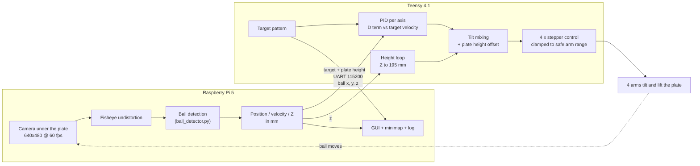

# Pong Stabilizer

A ball-on-plate balancer: a camera under a clear acrylic plate tracks a ping-pong
ball, and four stepper-driven arms tilt the plate to hold the ball still or move it
along patterns (circle, star, figure 8). It also keeps the plate at a set height
using the ball's distance from the camera.

- **Raspberry Pi 5**: camera, ball detection, GUI, sends the ball position.
- **Teensy 4.1**: PID control, target patterns, plate height, stepper motion.

Holds a still ball to within ~1-4 mm of the centre and follows moving patterns
within ~10-18 mm, at 60 fps, with no colour calibration needed when the room
lighting changes.

---

## Contents

1. [How it works](#how-it-works)
2. [Hardware](#hardware)
3. [Repository layout](#repository-layout)
4. [Setup](#setup)
5. [Running it](#running-it)
6. [Calibration](#calibration)
7. [Ball detection](#ball-detection)
8. [Control](#control)
9. [Serial protocol](#serial-protocol)
10. [Tuning](#tuning)
11. [Logging and monitoring](#logging-and-monitoring)
12. [Troubleshooting](#troubleshooting)
13. [Known issues](#known-issues)

---

## How it works



1. The Pi captures a frame, removes the fisheye distortion and finds the ball. It
   converts the ball's pixel position and apparent size into **X, Y and Z in mm**
   (Z = camera-to-ball distance) and sends them over UART.
2. The Teensy compares the ball with the current target (a still point or a moving
   pattern), runs a PID per axis to get pitch and roll, and mixes them into four arm
   angles.
3. A slow height loop moves all four arms together until the ball sits 195 mm from
   the camera. That keeps the plate at the same height every run, wherever the arms
   started.
4. The Teensy sends its target and plate height back, so the Pi's GUI and log show
   exactly what the controller is doing.

---

## Hardware

| Part | Details |
|---|---|
| Controller | Raspberry Pi 5 (vision, GUI) + Teensy 4.1 (control) |
| Camera | Raspberry Pi camera (IMX296 sensor), fisheye lens, mounted **under** the plate looking up |
| Plate | Clear, scratched acrylic octagon; flat edges ~110 mm from its centre |
| Ball | 40 mm translucent orange ping-pong ball |
| Actuation | 4 stepper motors, 3200 steps/rev, step/dir drivers; 4 arms (L1 = 98.1 mm, L2 = 92 mm, L3 = 54 mm), platform radius 110 mm |
| Encoders | MT6835 magnetic encoder driver included, **not used** at the moment |
| Link | Pi `/dev/ttyAMA0` ↔ Teensy `Serial1`, 115200 baud; Teensy also on the Pi's USB (power + flashing) |

Stepper pins (dir, step) on the Teensy: M0 (7, 8) right-back, M1 (3, 4)
right-front, M2 (5, 6) left-front, M3 (9, 10) left-back.

**Arm direction:** negative steps on M0/M2 and positive steps on M1/M3 raise the
arms. The firmware handles this; it matters if you change motor wiring.

**Power:** the Pi 5 needs a solid 5 V / 5 A supply, ideally separate from the motor
supply. Undervoltage resets ("Reset due to low power event") happened during testing.

---

## Repository layout

```
Pong-Stabilizer/
├── README.md                     this file
├── docs/
│   └── ball-tracking-and-control.md   detailed design notes, measurements, rationale
├── pi_code/
│   ├── camera_calib/             one-time fisheye calibration
│   │   ├── 1_capture_images.py   capture checkerboard images (9x7 squares)
│   │   ├── 2_calibrate_calc.py   compute K, D -> cam_calib_fisheye.npz
│   │   ├── 3_live_undestorted.py live preview of the undistorted image
│   │   └── calibration_images/   the captured checkerboard images
│   └── ball_tracking/
│       ├── ball_detector.py      shared detection + tracking module (start here)
│       ├── 4_gui_track_w_mode.py main tracker: GUI, pattern keys, minimap, logging
│       ├── 4_gui_track_pid.py    tracker with live PID sliders
│       ├── 4_headless_track.py   tracker without GUI
│       ├── 1_tune_color.py       HSV slider tuner (only for DETECTOR_MODE = "sliders")
│       ├── hsv_values.txt        HSV window for slider mode
│       ├── cam_calib_fisheye.npz camera calibration used by the trackers
│       ├── 2_track_ball.py       early standalone tracking demo (legacy)
│       └── 4_gui_track.py, 4_headless_track_pid.py   older trackers (legacy, old units)
└── teensy_code/                  PlatformIO project (teensy41, Arduino framework)
    ├── platformio.ini            depends on TeensyTimerTool
    ├── src/
    │   ├── main.cpp              start-up, patterns, height loop, main control loop
    │   ├── inverseKinematics.cpp PID + tilt mixing
    │   ├── stepperWrapper.cpp    timer-driven stepper motion with acceleration
    │   ├── uartComm.cpp          packet parser + Teensy -> Pi messages
    │   └── MT6835_encoder.cpp    encoder driver (unused)
    ├── include/                  headers; inverseKinematics.h holds most tuning constants
    ├── flash_teensy.sh           copy firmware to the Pi and flash the Teensy
    └── plot_data.py              plot x/y/z from a serial capture (out.txt)
```

---

## Setup

### Raspberry Pi

Raspberry Pi OS (Bookworm) with the camera enabled and the UART on
`/dev/ttyAMA0` enabled (serial console off).

```sh
sudo apt install python3-picamera2 python3-opencv python3-numpy python3-serial
git clone https://github.com/alexivan04/Pong-Stabilizer.git
cd Pong-Stabilizer/pi_code/ball_tracking
```

The trackers read `cam_calib_fisheye.npz` and `hsv_values.txt` from the current
directory, so run them from `pi_code/ball_tracking/`.

### Teensy firmware

Install [PlatformIO](https://platformio.org/) (CLI or the VS Code extension), then:

```sh
cd teensy_code
pio run            # builds .pio/build/teensy41/firmware.hex
```

`TeensyTimerTool` is fetched automatically (`platformio.ini`).

### Flashing

The Teensy is connected to the Pi by USB. The working method is a USB soft reboot
into the bootloader:

```sh
scp .pio/build/teensy41/firmware.hex <user>@<pi>:firmware.hex
ssh <user>@<pi> 'sudo teensy_loader_cli --mcu=TEENSY41 -s -w -v ~/firmware.hex'
```

`flash_teensy.sh <hex>` does the copy and then pulses GPIO 23 (the Teensy's program
pin) through `~/main.py` on the Pi. That pulse stopped working during testing; if
the loader sits at "Waiting for Teensy device", kill it and use the command above.

After flashing, the firmware **waits for START**, so the arms don't move until a
tracker is started.

---

## Running it

1. **Motors unpowered: rest all four arms on their mechanical low stop**, then power
   the motors. The arm position when START arrives becomes 0°.
2. On the Pi, in `pi_code/ball_tracking/`:
   ```sh
   python3 4_gui_track_w_mode.py
   ```
   It sends START. The arms lift off the stop (1 s) and balancing begins.
3. **Put the ball on right away.** The plate rises to ~195 mm from the camera while
   it balances (~25 s).
4. Keys in the tracking window:

   | Key | Action |
   |---|---|
   | `1` `2` `3` `4` | CENTER, CIRCLE, STAR, FIGURE 8 |
   | `5` | cycle all patterns, 25 s each (the start-up default) |
   | `m` | show / hide the detection mask |
   | `d` | save a snapshot (`snapshot_<time>_frame.png` + `_mask.png`) |
   | `Esc` | quit |

5. **Stopping** (`Esc`, `Ctrl-C` or `pkill -f "^python3 4_gui_track_w_mode.py"`)
   sends "ball lost" first, so the Teensy levels the plate. Stopping the Pi script
   does not cut motor power: in an emergency, switch the motors off.

Other trackers: `4_gui_track_pid.py` adds P/I/D sliders that are sent to the Teensy
live; `4_headless_track.py` runs without a window.

**Autostart:** `~/.config/autostart/ball_tracking.desktop` can start
`4_gui_track_w_mode.py` at login. It's currently disabled with `Hidden=true`.

---

## Calibration

### Camera (once per lens / mount)

1. `python3 1_capture_images.py` in `pi_code/camera_calib/`: show a 9x7-square
   checkerboard from many angles, `s` to save, `q` to finish.
2. `python3 2_calibrate_calc.py` writes `cam_calib_fisheye.npz` (K, D).
3. `python3 3_live_undestorted.py` to check the result; copy the `.npz` into
   `pi_code/ball_tracking/`.

### Ball colour: not needed

The default detector (`DETECTOR_MODE = "auto"`) needs no colour calibration. Only
if you switch to `"sliders"`, run `1_tune_color.py`. It shows the same undistorted
image and plate circle as the tracker. Tune hue and saturation, keep V wide, and
press `q` to save `hsv_values.txt`.

### Plate position

`PLATE_CENTER_PX` and `PLATE_RADIUS_MM` in `ball_detector.py` describe where the
plate is in the image. Re-measure them if the camera mount moves; a snapshot (`d`)
shows the plate clearly.

---

## Ball detection

Everything lives in `pi_code/ball_tracking/ball_detector.py`;
`create_tracker(new_K)` returns the tracker for `DETECTOR_MODE`.

**Why colour thresholds failed:** with the camera looking up through a hazy plate
at ceiling lights, skin, haze, the wooden table and a side panel all have the ball's
hue. Only saturation separates them. Brightness changes with the room light, so any
fixed HSV window breaks when the lighting changes.

**`"auto"` (default), calibration-free:** while lowering a saturation threshold step
by step, the ball shows up as a round, ball-sized blob whose outline stays the same
over many steps, a maximally stable region in the sense of MSER. The threshold is
chosen fresh every frame. A candidate must also:
- be round, judged on its convex hull so glare cutting into the edge doesn't matter;
- have its centre on the plate;
- be vividly coloured inside (rejects a dull brown patch seen through the plate).

When lost it searches the whole plate (~17 ms on a Pi 5); while tracking, only a
window around the ball (~2 ms).

**`"sliders"`, fallback:** a fixed HSV window from `hsv_values.txt`, limited to the plate.

**Plate area in mm:** the search area and plausible ball size are defined in mm and
converted to pixels using the measured plate distance, so they fit at any plate height.

**Z and smoothing:** Z comes from the ball's apparent radius. At ~200 mm the ball is
only ~13 px, so X/Y are scaled with a 15-frame median Z, and the Z sent to the Teensy
is a 5-frame median. That keeps radius noise from shaking the position.

Validated on real frames under simulated and real lighting changes: lights off, a
torch, backlight haze, warm/cool light. See the
[detailed notes](docs/ball-tracking-and-control.md#ball-detection-pi_codeball_trackingball_detectorpy).

---

## Control

All in `teensy_code/src/`; constants in `include/inverseKinematics.h`.

- **Loop:** every 5 ms. Ball position is smoothed (EMA, `ALPHA = 0.15`), compared with
  the target, and a PID per axis gives pitch/roll, limited to −10…+15°.
- **D term relative to the target:** `D · (ball velocity − target velocity)`, with the
  target smoothed like the ball. On a still target this is plain derivative on
  measurement. On moving patterns it stops braking a ball that is correctly following,
  which halved the tracking error.
- **Gains:** `Kp, Ki, Kd = 0.149, 0.112, 0.068 / UNIT_SCALE`. The Pi sends real mm;
  `UNIT_SCALE = 1.4` converts the original tuning, which was done in smaller units.
- **Patterns** (`main.cpp`): CENTER, CIRCLE (r 50 mm, 5 s), STAR (60/25 mm, 10 s),
  FIGURE 8 (60x30 mm, 6 s), or cycle all. The target moves at most 120 mm/s.
  `PATTERN_SCALE` sizes them.
- **Arm range:** arm angles are degrees above the low stop. Every command is clamped
  to 5°…40°, so the arms can't grind into the stop.
- **Plate height:** all arms share a height offset. It rises to 15° (tilt room), then
  follows the ball's Z to `Z_TARGET_MM = 195` (±4 mm), at up to 2°/s, within 15°…30°.
  It only adjusts while the ball is seen within 75 mm of the centre, and holds its
  height otherwise.
- **Start-up:** wait for START, take 0° as the current arm pose, lift to 5°, balance.

---

## Serial protocol

`0xAA | type | size | payload | XOR(type, size, payload…) | 0xBB`, 115200 baud.

| Type | Direction | Payload |
|---|---|---|
| 1 BALL_DATA | Pi → Teensy | `<Bffffff`: found, x, y, z [mm], vx, vy, vz [mm/s] (the Teensy uses the first 13 bytes) |
| 2 PID_UPDATE | Pi → Teensy | `<fff`: P, I, D |
| 3 START | Pi → Teensy | empty |
| 4 PATTERN_CHANGE | both ways | `<B`: pattern (0 CENTER, 1 CIRCLE, 2 STAR, 3 FIGURE 8, 4 cycle) |
| 5 TARGET_POS | Teensy → Pi | `<fff`: target x, y [mm], plate height [deg above the low stop] |

Coordinates are in mm relative to the camera's optical axis, with Z = camera-to-ball
distance (bigger = plate higher).

---

## Tuning

| File | Constant | Default | What it does |
|---|---|---|---|
| `ball_detector.py` | `DETECTOR_MODE` | `"auto"` | `"sliders"` for the HSV fallback |
| | `PLATE_CENTER_PX`, `PLATE_RADIUS_MM` | (324, 236), 117 | Plate position in the image / allowed ball area |
| | `MIN_PEAK_SAT` | 100 | Higher rejects more dull objects; lower if a glaring ball is missed |
| | `Z_MEDIAN_XY`, `Z_MEDIAN_OUT` | 15, 5 | More frames = steadier, slower |
| | `EXPOSURE_US`, `ANALOGUE_GAIN` | 20000, 2.0 | Fixed camera exposure |
| `inverseKinematics.h` + `ball_detector.py` | `UNIT_SCALE` | 1.4 | Higher = gentler PID (keep both files equal) |
| | `PATTERN_SCALE` | 1.0 | Pattern size and speed (keep both files equal) |
| `inverseKinematics.h` | `Z_TARGET_MM` | 195 | Plate height (camera-to-ball distance) |
| | `HEIGHT_GAIN`, `HEIGHT_RATE_DEG_S` | 0.05, 2 | Height loop speed; ~0.15 reaches the height in ~10 s |
| | `ARM_MIN_DEG`, `ARM_MAX_DEG` | 5, 40 | Arm limits above the low stop |
| `inverseKinematics.cpp` | `Kp`, `Ki`, `Kd` | 0.149/0.112/0.068 ÷ 1.4 | PID gains (or use `4_gui_track_pid.py` sliders live) |

---

## Logging and monitoring

- `TRACK_LOG=/tmp/track_run python3 4_gui_track_w_mode.py` writes `track.csv`
  (`t, found, x, y, z, vx, vy, target_x, target_y, pattern, height_deg` per frame)
  and `latest.jpg` every 2 s.
- The GUI shows status, X/Y/Z, velocities, the plate height (red with "(limit)" at the
  ends of its range), and a minimap with the Teensy's real target and the ball.
- `teensy_code/plot_data.py` plots x/y/z from a text capture (`out.txt`).

---

## Troubleshooting

| Symptom | Likely cause / fix |
|---|---|
| Arms grind at start-up | They weren't on the low stop when START arrived, or steps were lost; rest them on the stop and restart |
| Plate doesn't reach ~195 mm | Ball often > 75 mm from the centre (height loop pauses), or the GUI shows "(limit)": the 30° ceiling, check the start pose |
| Plate tilts away after stopping | Old script version without the "ball lost" exit; restart, or send a ball-lost packet |
| Nothing moves after flashing | Expected: the firmware waits for START from a tracker |
| Pi disappears from the network | Check the power supply (`vcgencmd get_throttled`, non-zero = undervoltage) |
| Ball not detected | Press `m` to see the mask; check the plate circle in the GUI matches the plate; try `DETECTOR_MODE = "sliders"` |
| Flash hangs at "Waiting for Teensy device" | GPIO pulse not working; kill the loader and flash with `teensy_loader_cli -s` |
| Cursor invisible on the Pi | Don't run `unclutter -idle 0` on Wayland |

---

## Known issues

- Pi 5 undervoltage resets under load: check the supply.
- The GPIO 23 bootloader pulse in `flash_teensy.sh` / `~/main.py` no longer works;
  use the USB soft reboot.
- `checkSerial()`: `rxBuffer` is 32 bytes and the size byte isn't bounds-checked, so a
  corrupted size can overflow it.
- `flash_teensy.sh` uses `set -u`, so running it without an argument shows "unbound
  variable" instead of the usage line.
- `4_gui_track.py` and `4_headless_track_pid.py` use the old detection and units, so
  the current gains make them too gentle. `4_gui_track_pid.py` doesn't yet read the
  Teensy's target / height packet.
- The upper arm limit (40°) is an estimate, not a measured mechanical limit.
- MT6835 encoders are wired in the code but unused; closed-loop step correction would
  remove the lost-step offset near the low stop.

More detail, measurements and the reasoning behind each change:
[docs/ball-tracking-and-control.md](docs/ball-tracking-and-control.md).
